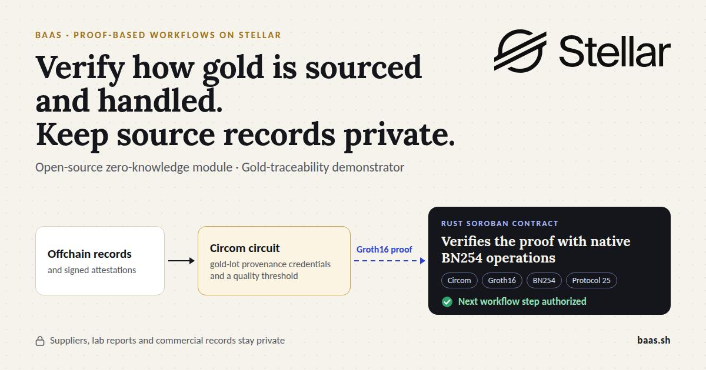

# Sealstep by BaaS.sh

Private business-rule verification on Stellar, with gold traceability as the first use case.

**Status:** the Sealstep contracts are not implemented yet. A feasibility test of the verifier is already deployed on Stellar testnet (see below).

## Feasibility test (done, self-funded)

A first Groth16/BN254 verifier runs on Stellar testnet, using host functions introduced in Protocol 25.

- Code: [soroban-groth16-verifier](https://github.com/JonathanOkz/soroban-groth16-verifier)
- Testnet contract: [CD4TNAQANCELKRSQ4XD2KFEAZN7CF6T7GDDJYZYWIIKFIY5D2HUKG7AI](https://stellar.expert/explorer/testnet/contract/CD4TNAQANCELKRSQ4XD2KFEAZN7CF6T7GDDJYZYWIIKFIY5D2HUKG7AI)
- Tests: valid proof → true; same proof with a wrong input → false; second valid proof → true
- Cost: 0.0023203 XLM per verification (excluding deployment)

This test uses a minimal multiplication circuit, not the Sealstep gold circuits, and is outside the SCF budget.

## What Sealstep will do

A business should be able to prove that a workflow rule was satisfied without publishing its underlying records. Sealstep will generate a zero-knowledge proof offchain and let a Soroban contract verify it before authorizing the next workflow step.

The first demonstrator follows a gold lot. A refiner or assay laboratory supplies signed provenance credentials and quality measurements. The proposed circuit checks the required credentials and quality threshold; the workflow contract advances the lot only when the proof is valid. Supplier identities, reports and commercial records remain offchain.

## Why Stellar

Protocol 25 introduced native BN254 operations and Poseidon permutation primitives in Soroban. These provide the cryptographic building blocks for the proposed Groth16 verifier and ZK-friendly commitments. Keeping verification and workflow state on Stellar allows other Soroban applications to consume the result on the same network.

The feasibility test confirms Groth16/BN254 verification on Soroban for a multiplication circuit. Verification costs and resource limits for the Sealstep gold circuits still need to be measured. See [Stellar's Protocol 25 announcement](https://stellar.org/blog/developers/announcing-stellar-x-ray-protocol-25) and [Stellar privacy documentation](https://developers.stellar.org/docs/build/apps/privacy).

## Proposed design

| Component | Planned responsibility |
| --- | --- |
| Circom circuits and Groth16 over BN254 | Prove business rules against private inputs and authenticated issuer records. |
| `WorkflowRegistry` | Store permitted states, rule versions and authorized issuer keys. |
| `ProofVerifier` | Verify Groth16 proofs using Soroban's native BN254 operations. |
| `LotWorkflow` | Authorize state transitions after proof verification. |
| SDK and reference dApp | Integrate proof generation, submission and gold-lot workflows. |

Proof public inputs will bind the lot and its current state, rule version, requested action, network and contract. The workflow will reject stale or replayed transitions. Source records will remain offchain, with Poseidon commitments linking them to the proof. Exact encodings and commitment parameters remain design work.

Physical checks remain the responsibility of trusted issuers: a proof cannot establish whether a real-world assay was honest. Registry administrators will register and revoke issuer keys. Transaction metadata remains public. Circuit-specific trusted setup, key governance, multisig administration and upgrade controls must be resolved before production use.

## Planned four-month delivery

- **Months 1–2:** circuits, registry and verifier; compatibility validation, trusted-setup design and testnet resource benchmarks.
- **Month 3:** SDK integration and the gold-workflow demonstrator.
- **Month 4:** application security testing, documentation and mainnet release.

The proposed scope covers Stellar components only. The module is intended to work independently of the BaaS platform and also integrate with it. Implementation is planned under Apache-2.0.

Natixar, a mineral-traceability company, signed a letter of interest to test Sealstep: [Natixar_LOI_BaaS_Stellar.pdf](docs/Natixar_LOI_BaaS_Stellar.pdf).

## Team and existing foundation

- [Jonathan Oleszkiewicz](https://github.com/JonathanOkz): technical architecture and proof-system integration.
- [Nour El Madhoun](https://scholar.google.com/citations?user=zRQNyEwAAAAJ&hl=fr): scientific validation of circuits and protocol design.
- [Ruslan Kasheparov](https://github.com/RuslanProgrammer): Soroban contracts, SDK and demonstrator development.

Existing BaaS developer tooling is described at [docs.baas.sh](https://docs.baas.sh). It provides an engineering foundation; it is distinct from this proposed Stellar module.

Relevant team research:

1. *Cross-Chain Interoperability: Local, Proved, and Checkpointed States* — IEEE ICBC 2026, published. [DOI](https://doi.org/10.1109/ICBC67748.2026.11575507).
2. *Checkpointability: Separating Proof Availability from Publication Liveness* — BRAINS 2026, accepted. [Conference program](https://brains.dnac.org/2026/program-2/).
3. *Blockchain Checkpoint Publication Under Uncertainty: Separating Relay Stalls from Interface Rejection* — CSNet 2026, accepted. [Conference program](https://csnet-conference.org/2026/program/).

Publication status checked on 9 October 2026. These papers support the team's research background; they are not evidence of a deployed Sealstep verifier.

## Project links

[BaaS.sh](https://baas.sh) · [Platform documentation](https://docs.baas.sh) · [Open a project issue](https://github.com/BaaS-sh/sealstep/issues)

## License

Apache-2.0, see [LICENSE](LICENSE).
