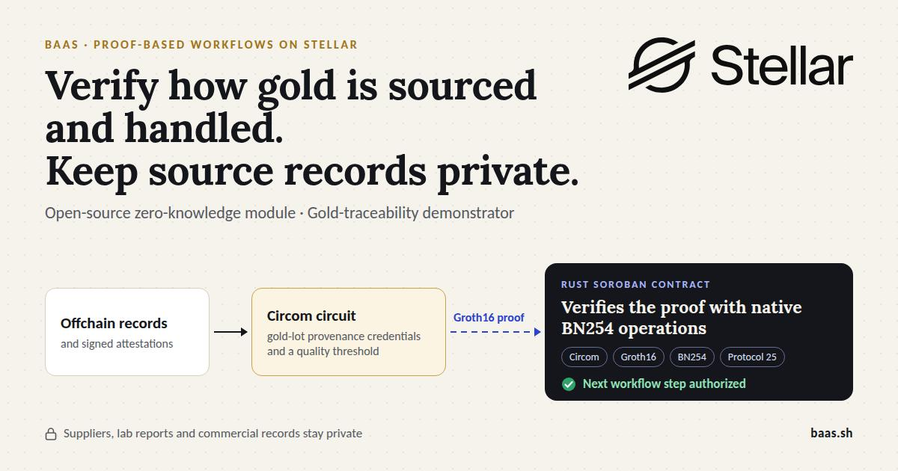

# Sealstep by BaaS.sh

Private business-rule verification on Stellar, with gold traceability as the first use case.

**Status:** the Sealstep contracts are not implemented yet. A feasibility test of the verifier is already deployed on Stellar testnet (see below).

## Feasibility test (done, self-funded)

A first Groth16/BN254 verifier runs on Stellar testnet, using host functions introduced in Protocol 25.

- Code: [soroban-groth16-verifier](https://github.com/JonathanOkz/soroban-groth16-verifier)
- Testnet contract: [CD4TNAQANCELKRSQ4XD2KFEAZN7CF6T7GDDJYZYWIIKFIY5D2HUKG7AI](https://stellar.expert/explorer/testnet/contract/CD4TNAQANCELKRSQ4XD2KFEAZN7CF6T7GDDJYZYWIIKFIY5D2HUKG7AI)
- Tests: valid proof → true; same proof with a wrong input → false; second valid proof → true
- Cost: 0.0023203 XLM per verification (excluding deployment)

This test uses a minimal multiplication circuit, not the Sealstep gold circuits, and is outside the SCF budget.

## What Sealstep will do

A business should be able to prove that a workflow rule was satisfied without publishing its underlying records. Sealstep will generate a zero-knowledge proof offchain and let a Soroban contract verify it before authorizing the next workflow step.

The first demonstrator follows a gold lot. A refiner or assay laboratory supplies signed provenance credentials and quality measurements. The proposed circuit checks the required credentials and quality threshold; the workflow contract advances the lot only when the proof is valid. Supplier identities, reports and commercial records remain offchain.

## Why Stellar

Protocol 25 introduced native BN254 operations and Poseidon permutation primitives in Soroban. These provide the cryptographic building blocks for the proposed Groth16 verifier and ZK-friendly commitments. Keeping verification and workflow state on Stellar allows other Soroban applications to consume the result on the same network.

The feasibility test confirms Groth16/BN254 verification on Soroban for a multiplication circuit. Verification costs and resource limits for the Sealstep gold circuits still need to be measured. See [Stellar's Protocol 25 announcement](https://stellar.org/blog/developers/announcing-stellar-x-ray-protocol-25) and [Stellar privacy documentation](https://developers.stellar.org/docs/build/apps/privacy).

## Proposed design

| Component | Planned responsibility |
| --- | --- |
| Circom circuits and Groth16 over BN254 | Prove business rules against private inputs and authenticated issuer records. |
| `WorkflowRegistry` | Store permitted states, rule versions and authorized issuer keys. |
| `ProofVerifier` | Verify Groth16 proofs using Soroban's native BN254 operations. |
| `LotWorkflow` | Authorize state transitions after proof verification. |
| SDK and reference dApp | Integrate proof generation, submission and gold-lot workflows. |

The full design is in the [architecture document (version 0.7)](docs/ARCHITECTURE.md): components, data model, protocol flows, delivery roadmap and security model.

Proof public inputs will bind the lot and its current state, rule version, requested action, network and contract. The workflow will reject stale or replayed transitions. Source records will remain offchain, with Poseidon commitments linking them to the proof. Exact encodings and commitment parameters remain design work.

Physical checks remain the responsibility of trusted issuers: a proof cannot establish whether a real-world assay was honest. Registry administrators will register and revoke issuer keys. Transaction metadata remains public. Circuit-specific trusted setup, key governance, multisig administration and upgrade controls must be resolved before production use.

## Planned four-month delivery

- **Months 1–2:** circuits, registry and verifier; compatibility validation, trusted-setup design and testnet resource benchmarks.
- **Month 3:** SDK integration and the gold-workflow demonstrator.
- **Month 4:** application security testing, documentation and mainnet release.

The proposed scope covers Stellar components only. The module is intended to work independently of the BaaS platform and also integrate with it. Implementation is planned under Apache-2.0.

Natixar, a mineral-traceability company, signed a letter of interest to test Sealstep: [Natixar_LOI_BaaS_Stellar.pdf](docs/Natixar_LOI_BaaS_Stellar.pdf).

## Roadmap

### Deliverable 1.1: Gold workflow circuits
- **Description:** Circom circuits proving that required document checks pass and that weight and gold-content discrepancies are correctly calculated, from issuer-signed records committed with Poseidon. Five circuits, one per custody action (mine shipment, transport, refinery receipt, assay, refining), binding the ten public inputs of the architecture document. Development trusted setup for these new circuits. The demo circuit of the feasibility test (a x b = c) is not part of this deliverable.
- **Work included:**
   1. Specify the gold lot record schema (mine shipment, transport, receipt, assay, refining) and rule set v1, based on the document types used in the Natixar proof of concept.
   2. Verify EdDSA-Poseidon issuer signatures on Baby Jubjub inside the circuit, so that only records signed by a registered issuer key can be used.
   3. Commit each record in two salted parts (handover and private, 248-bit salts) with Poseidon; issuer key hashes use circomlib's Poseidon parameters, matched onchain by the Protocol 25 permutation and checked by shared test vectors.
   4. Compute weight and fine gold content discrepancies between declared and measured values, with the tolerance set by the rule version, and expose them as public signals.
   5. Bind the ten public inputs in a fixed order: lot identifier, action, domain (network and contract), operator, issuer key hash, record commitment, two reference commitments, weight delta and gold-content delta. State and rule version come from the lot entry; the step slot (lot, action) acts as the nullifier.
   6. Development powers-of-tau and phase-2 setup for the gold circuits, offchain verification with snarkjs before any onchain call.
   7. Publish constraint counts and proving times on a standard laptop, so integrators know the real cost of proving.
- **Already existing, reused and not billed:** the feasibility test's demo circuit (a x b = c) and its build scripts, used as tooling only.
- **Research partner:** soundness review of the gold circuits and test vectors by our Isep research partner (not funded by this grant).
- **Measure of completion:** Circuits, test vectors and development setup published; valid lots produce proofs that verify offchain; at least 10 invalid cases are rejected (tampered document, wrong weight, wrong gold content, revoked issuer, wrong action); CI passing.
- **Reviewer evidence:** Repository tag, CI run, test vector list.
- **Estimated date:** T+6 weeks after award.
- **Team:** Jonathan Oleszkiewicz 35 h, Ruslan Kasheparov 130 h, Yosra Helal 60 h.
- **Budget:** \$20,000 (225 h).

### Deliverable 1.2: WorkflowRegistry on testnet
- **Description:** New contract storing permitted states and transitions, rule versions and issuer keys, with register, suspend and revoke flows under multisig administration. Nothing of this contract exists today.
- **Work included:**
   1. States and allowed transitions per workflow, stored onchain.
   2. Rule versions frozen at publication, with an activation ledger and a deprecated flag; each lot keeps the rule version it started with. Exercised with test verifier addresses; the first gold rule version pointing to the ProofVerifier instances comes with 1.3.
   3. Issuer keys with role, validity window and status; register (with coordinate checks and Poseidon key hash), suspend, unsuspend and revoke flows.
   4. Administration: admin multisig (three signers, thresholds at 2) and guardian role for emergency pause or suspension; access control, roles and pause use OpenZeppelin Stellar Contracts; no upgrade function.
   5. Unit tests, integration tests on a local network, testnet deployment with stellar-cli, source verification on StellarExpert.
- **Measure of completion:** Contract deployed on Stellar testnet with source verified on StellarExpert; register, revoke and rule-versioning flows exercised by transactions; negative tests (unauthorized caller, revoked issuer, unknown rule version) passing in CI.
- **Reviewer evidence:** Testnet contract ID, transaction hashes, CI run.
- **Estimated date:** T+7 weeks after award.
- **Team:** Jonathan Oleszkiewicz 25 h, Ruslan Kasheparov 90 h, Yosra Helal 15 h.
- **Budget:** \$11,675 (130 h).

### Deliverable 1.3: Production ProofVerifier on testnet
- **Description:** Turns the single-key feasibility verifier into a production verifier. Funded work only: one verifying key per gold circuit fixed at deployment, point and length validation, vk_x computed with BN254 multi-scalar multiplication (Protocol 26), events, admin and pause, and cost measurement on the gold circuits. The existing pairing check, demo verifying key and test scripts are reused and not billed.
- **Work included:**
   1. One deployment per gold circuit, with its verifying key fixed in the constructor instead of compiled for a single demo circuit.
   2. Validation of point encodings and input lengths before any pairing, with explicit error codes.
   3. vk_x computed with BN254 multi-scalar multiplication (CAP-0080, Protocol 26), then the pairing check (CAP-0074).
   4. circuit_id computed onchain as a hash of the stored key; verification events, admin and pause through the same multisig administration as WorkflowRegistry; five instances deployed on testnet with development keys.
   5. Cost per verification measured on the gold circuits by simulation and on testnet, and published.
- **Already existing, reused and not billed:** the feasibility verifier's BN254 pairing check, demo verifying key and test scripts (contract CD4TNAQ..., self-funded).
- **Research partner:** review of input validation and verifying-key handling by our Isep research partner (not funded by this grant).
- **Measure of completion:** Verifier deployed on testnet with verified source and the gold-circuit verifying keys; gold-circuit proofs verified onchain; cost per verification on the gold circuits published; negative tests (malformed proof, invalid point, wrong public input, wrong circuit) passing in CI.
- **Reviewer evidence:** Testnet contract ID, transaction hashes, CI run, cost report.
- **Estimated date:** T+8 weeks after award.
- **Team:** Jonathan Oleszkiewicz 20 h, Ruslan Kasheparov 60 h, Yosra Helal 15 h.
- **Budget:** \$8,575 (95 h).

**Tranche 1 total:** \$40,250. SCF payment released on completion: 20% of the award (\$19,000).

### Deliverable 2.1: LotWorkflow contract on testnet
- **Description:** Custody state machine for a gold lot from mine shipment to refining. It runs checks A to E (access, step slot, rules, proof, accept), accepts each step slot (lot, action) once, records rejections with their reason without changing state, and records discrepancies for review without blocking the step.
- **Work included:**
   1. Lot creation and custody transitions: mine shipment, transport, refinery receipt, assay, refining.
   2. Operator roles set by the admin; per-transition checks onchain: permitted transition for the lot's rule version, public inputs matching lot, domain, operator and reference records, issuer active with the right role, valid proof.
   3. Replay protection by step slot in persistent storage (replay_rejected, conflicting_record), TTL policy with extend_ttl callable by any keeper, and void_lot for incident recovery.
   4. Discrepancy records (lot, step, weight delta, gold-content delta, rule version) stored for review; a discrepancy alone never blocks the step.
   5. Events for every transition, rejection and discrepancy, used later by the monitoring plan.
   6. End-to-end script running a sample lot through every state on testnet, and measured cost of a full transition.
- **Measure of completion:** Contract deployed on testnet with verified source; scripted end-to-end run of a sample lot from mine shipment to refining, including at least one rejected transition, one rejected replay and one recorded discrepancy; full transition cost published.
- **Reviewer evidence:** Testnet contract ID, transaction hashes, run script in the repository.
- **Estimated date:** T+11 weeks after award.
- **Team:** Jonathan Oleszkiewicz 20 h, Ruslan Kasheparov 70 h, Yosra Helal 20 h.
- **Budget:** \$9,850 (110 h).

### Deliverable 2.2: Sealstep SDK beta and gold demonstrator on testnet
- **Description:** TypeScript SDK for proof generation, submission and workflow queries over Stellar RPC. Demonstrator dApp where operators connect through Stellar Wallets Kit and move a sample gold lot through the workflow.
- **Work included:**
   1. SDK modules: issuer key generation and record signing, witness and local Groth16 proving (browser or Node.js, prover files hash-pinned), operator signer, typed clients for WorkflowRegistry, ProofVerifier and LotWorkflow generated with stellar-cli, simulation, submission and lot, step and event queries through Stellar RPC, tests and npm packaging. The proof encoding logic of the feasibility scripts is reused inside the SDK and not billed.
   2. Demonstrator built only on the public SDK: four views (mine, transporter, refiner, reviewer), wallets through Stellar Wallets Kit (listed integration time under one day, about 6 hours included here), sample lot with demo issuer keys, including a rejected transition, a rejected replay and a recorded discrepancy.
   3. SDK beta published on npm with an API reference.
- **Already existing, reused and not billed:** the proof generation and encoding scripts of the feasibility test.
- **Measure of completion:** SDK beta published as an open-source npm package with API reference; demonstrator live on testnet completing a full lot workflow.
- **Reviewer evidence:** npm package link, demonstrator URL, recorded walkthrough video.
- **Estimated date:** T+13 weeks after award.
- **Team:** Jonathan Oleszkiewicz 15 h, Ruslan Kasheparov 70 h, Yosra Helal 25 h.
- **Budget:** \$9,725 (110 h).

### Deliverable 2.3: STRIDE threat model and onchain monitoring plan
- **Description:** Dataflow diagram with trust boundaries (issuers, registry admins, operators, proof generation, contracts), STRIDE threat enumeration with mitigations, and a monitoring plan listing the security-relevant events to watch (rejections, replays, conflicting records, issuer suspension or revocation, admin and signer changes, pause) with recommended responses for deployment operators. It adds no monitoring service to Sealstep. Follows SDF's threat-modeling guide and builders' monitoring template.
- **Work included:**
   1. Dataflow diagram: issuers, registry admins, operators, proof generation (client side), Soroban contracts, Stellar RPC.
   2. STRIDE enumeration, including at least: forged or stolen issuer key, compromised admin signer, replayed transition, verifying key substitution, Poseidon parameter mismatch between circuit and contract, nullifier storage expiry, an under-constrained circuit accepting false statements, denial of service with costly invalid proofs.
   3. Mitigation for each threat and the residual risk.
   4. Monitoring plan from SDF's builders' template: each high-severity threat mapped to the contract events that reveal it and the recommended response.
- **Research partner:** review of the threat model by our Isep research partner (not funded by this grant).
- **Measure of completion:** Threat model, dataflow diagram and monitoring plan published in the repository documentation.
- **Reviewer evidence:** Public links to the three documents.
- **Estimated date:** T+13 weeks after award.
- **Team:** Jonathan Oleszkiewicz 15 h, Ruslan Kasheparov 10 h, Yosra Helal 25 h.
- **Budget:** \$4,625 (50 h).

### Deliverable 2.4: Production trusted setup ceremony
- **Description:** Multi-party phase-2 Groth16 ceremony for the gold circuits, replacing the development setup, so that no single party can forge proofs.
- **Work included:**
   1. Phase 1 reused from the Perpetual Powers of Tau; phase 2 per gold circuit, on the circuits frozen after 2.1, with at least three independent contributors and a random beacon from a Stellar mainnet ledger announced in advance. If 3.1 changes a circuit, its phase 2 runs again before mainnet.
   2. Publication of the transcript, contribution hashes and a verification script anyone can run.
   3. Production verifying keys derived from the ceremony and used for the mainnet deployment.
- **Already existing, reused and not billed:** nothing; the feasibility test used a single-party demo setup that is not reused for production.
- **Research partner:** our Isep research partner contributes to the ceremony, in addition to at least three independent contributors (not funded by this grant).
- **Measure of completion:** Ceremony completed with at least 3 independent contributors; transcript, contribution hashes and a verification script published; production verifying keys derived from it.
- **Reviewer evidence:** Transcript and verification script in the repository; anyone can re-run the check.
- **Estimated date:** T+13 weeks after award.
- **Team:** Jonathan Oleszkiewicz 10 h, Ruslan Kasheparov 20 h, Yosra Helal 20 h.
- **Budget:** \$4,500 (50 h).

**Tranche 2 total:** \$28,700. SCF payment released on completion: 30% of the award (\$28,500).

### Deliverable 3.1: Application security testing and remediation
- **Description:** Property-based and fuzz tests on the three contracts, negative-path tests on the circuits, static analysis in CI (Scout), and fixes. Produces the Soroban Security Audit Bank readiness package. This is application security testing by the team, not a third-party audit.
- **Work included:**
   1. Property-based tests and fuzzing on the three contracts (malformed proofs, boundary values, state machine invariants).
   2. Circuit review for under-constrained signals with malicious-witness tests, Circomspect and Picus, plus negative tests for every rule.
   3. Scout static analysis in CI on every pull request.
   4. Remediation of findings and a remediation log; readiness package for the Soroban Security Audit Bank (threat model, dataflow diagram, test results, scan results).
- **Research partner:** review of the circuit test plan and of the remediation log by our Isep research partner (not funded by this grant).
- **Measure of completion:** Test and scan reports published with a remediation log; all critical and high findings fixed.
- **Reviewer evidence:** Reports, remediation log, fix commits.
- **Estimated date:** T+16 weeks after award.
- **Team:** Jonathan Oleszkiewicz 20 h, Ruslan Kasheparov 60 h, Yosra Helal 40 h.
- **Budget:** \$10,700 (120 h).

### Deliverable 3.2: Developer documentation, integration guide and SDK 1.0
- **Description:** Guide to integrate a new workflow with Sealstep: writing a compatible circuit, registering rules and issuers, using the SDK. SDK released as 1.0.
- **Work included:**
   1. Documentation site: concepts, contract reference, SDK reference.
   2. Integration guide: write a compatible circuit, register states, rules and issuers, call LotWorkflow-style contracts from the SDK.
   3. Second sample workflow, not gold, built only from the guide and run on testnet, to prove reuse without new contract code.
   4. SDK 1.0 release on npm with semantic versioning.
- **Measure of completion:** Documentation published; a second sample workflow (non-gold) built only from the guide and running on testnet; SDK 1.0 on npm.
- **Reviewer evidence:** Documentation URL, sample repository, testnet transaction hashes, npm release.
- **Estimated date:** T+17 weeks after award.
- **Team:** Jonathan Oleszkiewicz 10 h, Ruslan Kasheparov 50 h, Yosra Helal 24 h.
- **Budget:** \$7,390 (84 h).

### Deliverable 3.3: Mainnet release
- **Description:** Mainnet deployment of WorkflowRegistry, ProofVerifier and LotWorkflow with production verifying keys, verified source and multisig administration; demonstrator switched to mainnet on sample data with demo issuer keys; security-event checks from the 2.3 plan demonstrated on the mainnet deployment. Real issuer keys and real lots come only after the Soroban Security Audit Bank report is published and addressed.
- **Work included:**
   1. Mainnet deployment runbook, executed and published.
   2. Admin multisig set up on mainnet from the first transaction: three signers on separate devices, all thresholds at 2, master key weight 0; guardian role granted.
   3. WorkflowRegistry, the five ProofVerifier instances (ceremony keys checked against the transcript) and LotWorkflow deployed with verified source; deployment manifest published.
   4. Demonstrator switched to mainnet with mainnet demo issuer keys (short validity window, revoked after the run); security-event checks from the 2.3 plan demonstrated.
   5. At least 50 verified workflow steps on sample data executed through the demonstrator, visible on StellarExpert.
- **Measure of completion:** Three contracts live on mainnet with verified source; deployment manifest published; at least 50 verified workflow steps on sample data executed through the team's demonstrator on mainnet.
- **Reviewer evidence:** Mainnet contract IDs, deployment manifest, transaction hashes, runbook.
- **Estimated date:** T+17 weeks after award.
- **Team:** Jonathan Oleszkiewicz 26 h, Ruslan Kasheparov 60 h, Yosra Helal 0 h.
- **Budget:** \$7,960 (86 h).

**Tranche 3 total:** \$26,050. SCF payment released on completion: 40% of the award (\$38,000).

## Team and existing foundation

- [Jonathan Oleszkiewicz](https://github.com/JonathanOkz), CEO and Blockchain developer
- Patrice Van de Velde, COO and Research engineer
- [Ruslan Kasheparov](https://github.com/RuslanProgrammer), PhD researcher and Blockchain developer
- [Nour EL MADHOUN](https://scholar.google.com/citations?user=zRQNyEwAAAAJ&hl=fr), Ruslan’s PhD supervisor at Isep
- [Yosra Helal](https://github.com/yosrahelal), Senior Blockchain developer

Existing BaaS developer tooling is described at [docs.baas.sh](https://docs.baas.sh). It provides an engineering foundation; it is distinct from this proposed Stellar module.

Relevant team research:

1. *Cross-Chain Interoperability: Local, Proved, and Checkpointed States* — IEEE ICBC 2026, published. [DOI](https://doi.org/10.1109/ICBC67748.2026.11575507).
2. *Checkpointability: Separating Proof Availability from Publication Liveness* — BRAINS 2026, accepted. [Conference program](https://brains.dnac.org/2026/program-2/).
3. *Blockchain Checkpoint Publication Under Uncertainty: Separating Relay Stalls from Interface Rejection* — CSNet 2026, accepted. [Conference program](https://csnet-conference.org/2026/program/).

Publication status checked on 9 October 2026. These papers support the team's research background; they are not evidence of a deployed Sealstep verifier.

## Project links

[BaaS.sh](https://baas.sh) · [Platform documentation](https://docs.baas.sh) · [Open a project issue](https://github.com/BaaS-sh/sealstep/issues)

## License

Apache-2.0, see [LICENSE](LICENSE).
