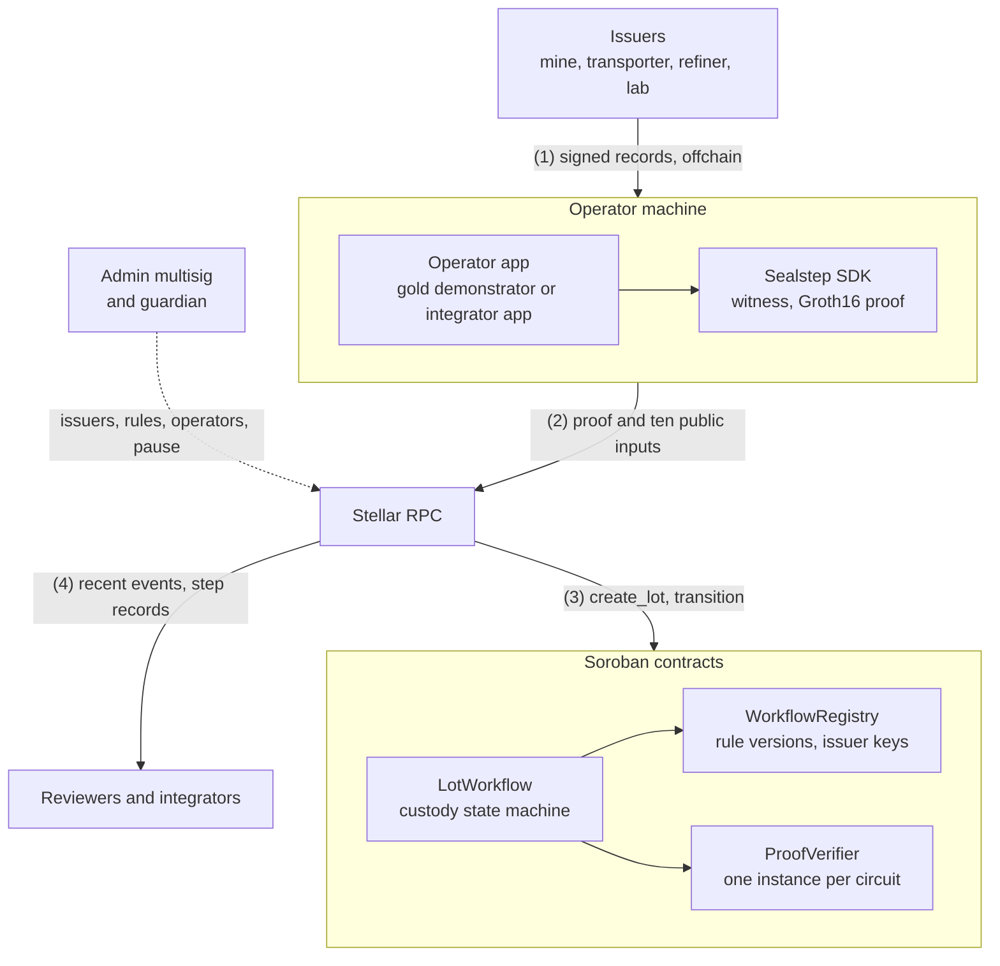
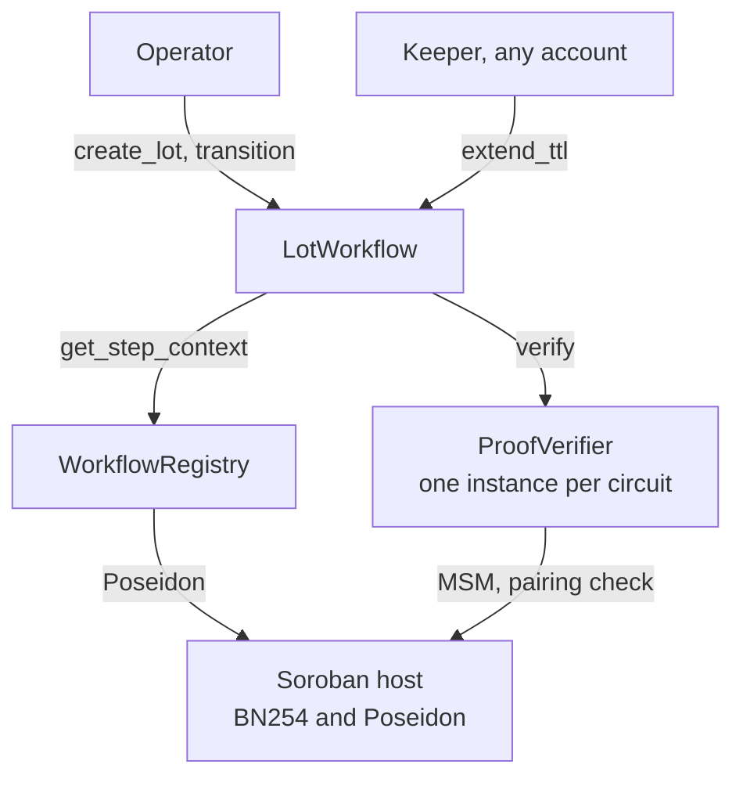
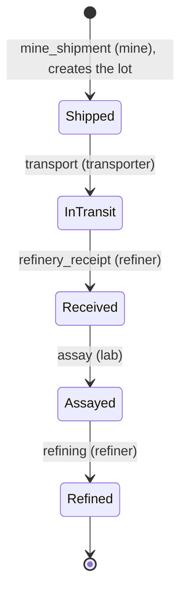
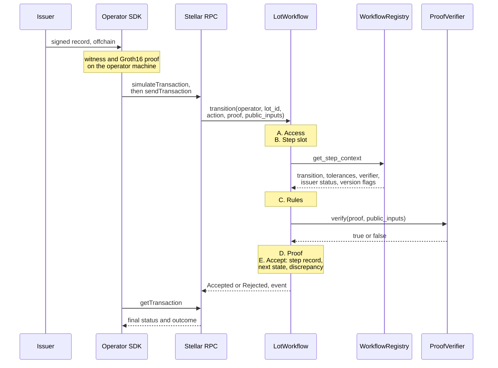

# Sealstep Architecture

Companies along a supply chain hold the evidence of what they did, but they do not want to publish it. Sealstep lets one of them prove on Stellar that a business rule was met, without publishing the records the proof is computed from. This document describes the target architecture of Sealstep, an open-source module by BaaS.sh: its contracts, circuits, SDK and demonstrator. It is written for the reviewers of the submission, security auditors and integrators.

Only the feasibility verifier of §1.4 exists today. Everything else is target design. Component names and deliverable numbers (1.1 to 3.3) match the Sealstep submission to the Stellar Community Fund (SCF), delivered in three tranches (§6).

Project page: [baas.sh/sealstep](https://baas.sh/sealstep). Version 0.7, 29 October 2026; this version narrows the document to the open-source module. Where the project page or the repository README differs from this document, this document applies.

## Summary

Sealstep lets an operator (the company submitting a custody step) prove on Stellar that confidential records satisfy a published rule. Issuers, the companies that produce the records, sign them offchain. The operator computes a Groth16 proof on its own machine and submits it with ten public inputs. The first workflow follows a gold lot from mine shipment to refining.

Three Soroban contracts do the checking. WorkflowRegistry holds rule versions and trusted issuer keys. ProofVerifier checks the proof with Stellar's native BN254 host functions. LotWorkflow moves the lot through its states. None of the three can be upgraded. An admin multisig registers issuers and publishes rules. Every decision leaves a public event that anyone can watch.

The chain stores identifiers, commitments and deltas, not the records (§7.2). A delta (the deviation of a measured value from its reference) above its tolerance is recorded as a discrepancy for a reviewer; the step is still accepted. Sealstep cannot prove that the physical check behind a record was honest (§7.3).

One part works today: a Groth16 proof generated with Circom and snarkjs verifies in a Soroban contract on testnet for 0.0023203 XLM. The cost of a full transition is unmeasured until deliverables 1.3 and 2.1. No component has had an external audit yet; the mainnet release runs on sample data with demo issuer keys and real lots start only after the audit (§6).

## Contents

- [1. Product overview](#1-product-overview)
  - [1.1 High-level product diagram](#11-high-level-product-diagram)
  - [1.2 Layered architecture and technical stack](#12-layered-architecture-and-technical-stack)
  - [1.3 Product positioning](#13-product-positioning)
  - [1.4 What exists today](#14-what-exists-today)
  - [1.5 Stellar integration](#15-stellar-integration)
- [2. Core components](#2-core-components)
  - [2.0 Component interaction map](#20-component-interaction-map)
  - [2.1 WorkflowRegistry contract](#21-workflowregistry-contract)
  - [2.2 ProofVerifier contract](#22-proofverifier-contract)
  - [2.3 LotWorkflow contract](#23-lotworkflow-contract)
  - [2.4 Gold workflow circuits and trusted setup](#24-gold-workflow-circuits-and-trusted-setup)
  - [2.5 Sealstep SDK and local prover](#25-sealstep-sdk-and-local-prover)
  - [2.6 Gold demonstrator](#26-gold-demonstrator)
- [3. Core data model](#3-core-data-model)
  - [3.1 Custody record and commitment](#31-custody-record-and-commitment)
  - [3.2 Step slot](#32-step-slot)
  - [3.3 Issuer key](#33-issuer-key)
  - [3.4 Rule version](#34-rule-version)
  - [3.5 Lot](#35-lot)
  - [3.6 Public inputs](#36-public-inputs)
  - [3.7 Discrepancy](#37-discrepancy)
  - [3.8 Record custody and disclosure](#38-record-custody-and-disclosure)
- [4. Protocol flows](#4-protocol-flows)
  - [4.0 Gold custody state machine](#40-gold-custody-state-machine)
  - [4.1 Custody step](#41-custody-step)
  - [4.2 Other scenarios](#42-other-scenarios)
  - [4.3 Incident recovery](#43-incident-recovery)
- [5. System topology](#5-system-topology)
- [6. Delivery roadmap](#6-delivery-roadmap)
  - [6.1 Testing strategy](#61-testing-strategy)
- [7. Trust and security model](#7-trust-and-security-model)
  - [7.0 Trust boundaries](#70-trust-boundaries)
  - [7.1 Proof and verifier lifecycle](#71-proof-and-verifier-lifecycle)
  - [7.2 Contract state and minimal onchain exposure](#72-contract-state-and-minimal-onchain-exposure)
  - [7.3 Issuer trust model](#73-issuer-trust-model)
  - [7.4 Governance, immutability and redeployment](#74-governance-immutability-and-redeployment)
  - [7.5 Threat assumptions](#75-threat-assumptions)
- [8. Future work: other workflows on Stellar](#8-future-work-other-workflows-on-stellar)
- [9. Appendices](#9-appendices)
  - [9.1 Document relationships](#91-document-relationships)
  - [9.2 Open design decisions](#92-open-design-decisions)
  - [9.3 Glossary](#93-glossary)
  - [9.4 License](#94-license)
  - [9.5 Use of AI tools](#95-use-of-ai-tools)

## 1. Product overview

Sealstep is a verification layer for multi-party workflows on Stellar. An operator proves that a rule was met without handing over the documents behind it. It has three parts. Issuers sign custody records offchain with keys registered onchain. The Sealstep SDK computes proofs on the operator's machine and builds Soroban transactions. Three Soroban contracts hold the rules, verify the proofs and keep the custody history. In the first workflow a gold lot goes through five custody steps: mine shipment, transport, refinery receipt, assay and refining (§4.0). At each step, an authorized operator generates a proof that signed records satisfy the required checks.

### 1.1 High-level product diagram



Solid edges are the data plane, the dotted edge the control plane. Every call from outside the chain goes through Stellar RPC.

| Actor | Onchain identity | Role | Trusted for |
|---|---|---|---|
| Issuer | Key hash in WorkflowRegistry (§3.3) | Signs one record per physical check | Honest signing |
| Operator | Stellar address with one or more operator roles in LotWorkflow | Proves the records of its step and submits the proof, through the demonstrator or its own app; may also be an issuer | Timely submission (it cannot forge a step) |
| Reviewer | None | Reads discrepancies and events, then decides offchain | Nothing (it reads public data) |
| Admin multisig | Stellar account with multisig thresholds | Registers issuers and operators, publishes rule versions, pauses and unpauses | Governance, within its threshold |
| Guardian | Stellar account holding the guardian role | Pauses a contract or suspends an issuer key in an emergency | Speed (it cannot unpause or unsuspend) |

### 1.2 Layered architecture and technical stack

| Layer | Technology | Responsibility |
|---|---|---|
| Application | Gold demonstrator, integrator applications | One view per party, sample lots |
| Client protocol | TypeScript SDK, circuit WASM and snarkjs in a browser or Node.js | Record checks, witness, Groth16 proof, encoding, operator signature |
| Circuits | Circom, circomlib, snarkjs | One circuit per custody action: issuer signature, commitments, deltas |
| Contracts | Rust, soroban-sdk, OpenZeppelin Stellar Contracts | Rule versions, issuer keys, custody state, step records, discrepancies, verification |
| Native cryptography | BN254 host functions (Core Advancement Proposals CAP-0074 and CAP-0080), Poseidon permutation (CAP-0075) through the soroban-poseidon crate | Pairing check, multi-scalar multiplication (MSM), issuer key hashes |
| Ledger | Stellar ledger, Stellar RPC | Ordering, finality, events, transaction submission |
| Tooling | stellar-cli, StellarExpert, Scout, GitHub Actions | Build, bindings, deployment, source verification, static analysis, CI |

Versions are pinned in the repository lock files; today they are those of the feasibility verifier (§1.4).

### 1.3 Product positioning

Sealstep adds an application layer above Stellar's native zero-knowledge primitives, the BN254 and Poseidon host functions of Protocols 25 and 26. That layer holds workflow state, an issuer registry, rule versions and replay protection. The first workflow, gold custody, is designed from the document types of Natixar's gold proof of concept in Guyana and from the maintainers' research on proved and checkpointed states (IEEE ICBC 2026).

Sealstep is not a privacy wallet, a token or a custodian and adds no cryptographic primitive. No Sealstep server receives the records and the chain stores no names, documents or measured values. Issuer key hashes, operator addresses and lot identifiers are pseudonymous but linkable (§7.2). Sealstep records discrepancies and leaves the decision to a reviewer. It defines no rules for how companies exchange their records.

### 1.4 What exists today

Only the starting point exists today (the status of each component is in §6):

- A Groth16/BN254 feasibility verifier runs on Stellar testnet at [`CD4TNAQANCELKRSQ4XD2KFEAZN7CF6T7GDDJYZYWIIKFIY5D2HUKG7AI`](https://stellar.expert/explorer/testnet/contract/CD4TNAQANCELKRSQ4XD2KFEAZN7CF6T7GDDJYZYWIIKFIY5D2HUKG7AI), with its source verified on StellarExpert and its code in [JonathanOkz/soroban-groth16-verifier](https://github.com/JonathanOkz/soroban-groth16-verifier).
- Three cases ran on testnet on 14 October 2026: a valid proof accepted, the same proof with a wrong public input rejected and a second valid proof accepted. Each verification cost 0.0023203 XLM, inclusion fee included and deployment excluded.
- The verifier checks a one-input demo circuit with a key compiled into the contract and taken from a single-party setup. Neither the circuit nor the key is reused in any deployment; both stay as test fixtures.
- The run exercised a Soroban contract, the BN254 pairing check, Stellar RPC and StellarExpert source verification. MSM, Poseidon and Soroban authorization stay untested until deliverables 1.2, 1.3 and 2.1.

### 1.5 Stellar integration

Sealstep uses six Stellar features: Soroban contracts, the BN254 host functions, the Poseidon host function, Soroban authorization, Stellar RPC and StellarExpert. The subsections below are the Stellar-specific reference; a first read can go straight to §2.

#### 1.5.1 Soroban contracts, storage and TTL

No contract imports an upgrade module or calls `update_current_contract_wasm` (§7.4). All three contracts use OpenZeppelin Stellar Contracts for access control, roles and pausing.

Instance storage holds configuration and, in ProofVerifier, the verifying key. Persistent storage holds everything that grows with use. Workflow data stays out of temporary storage: a deleted step record (§2.3) would let a step be replayed.

Storage time to live (TTL) policy:

- an expired persistent or instance entry is archived, not deleted; it can be restored but not recreated, so an archived step record still blocks a replay,
- since Protocol 23 a transaction automatically restores the archived entries that its simulation lists, at the submitter's expense,
- every write extends the entries it touches to the maximum TTL the network allows,
- any account, called a keeper, can call `extend_ttl` to extend the TTL of lots, their step records and discrepancies.

A keeper spares operators the cost of a restore. Safety does not depend on it.

#### 1.5.2 Native cryptography in Protocols 25 and 26

Sealstep uses host functions instead of curve arithmetic compiled into contract code:

- the BN254 multi-pairing check (CAP-0074, Protocol 25) evaluates the Groth16 equation,
- the BN254 G1 MSM (CAP-0080, Protocol 26) combines the verifying key with the ten public inputs in one host call,
- BN254 point decoding rejects points off the curve or outside the G2 subgroup,
- the Poseidon permutation (CAP-0075, Protocol 25) computes issuer key hashes onchain.

CAP-0080 has been available on testnet and mainnet since Protocol 26. A WASM that imports the MSM host function does not load on a Protocol 25 network. The feasibility verifier's per-input path (one `g1_mul` and one `g1_add` per input) stays in the cost report as a baseline.

**Why Groth16 rather than UltraHonk.** A Groth16 proof is three curve points (256 bytes) and verifies with one multi-pairing check, native on Soroban since Protocol 25. UltraHonk needs no circuit-specific setup, but its proofs are larger and its onchain verifier is costlier. Sealstep accepts a circuit-specific setup and runs it as the multi-party ceremony of deliverable 2.4.

#### 1.5.3 Stellar RPC, events and finality

The SDK and the demonstrator use five RPC methods.

| RPC method | Purpose |
|---|---|
| `simulateTransaction` | Footprint and resource fee of a call |
| `sendTransaction` | Submission of the signed transaction |
| `getTransaction` | Final status and the outcome returned by the contract |
| `getLedgerEntries` | Lots, step records and rule versions |
| `getEvents` | Recent contract events |

Every step that reaches a decision emits an event that names the operator and the rule version (§4.2). Events are the public interface for anyone who watches a deployment. A reader filters them by the contract IDs of the deployment manifest (§1.5.5), so a contract that copies Sealstep event names cannot inject data.

A failed access check reverts with no Sealstep event. A simulation leaves nothing on the ledger: a proof can be tested through `simulateTransaction` without a trace.

Accepted step records stay in contract storage. Event and transaction queries are limited by the RPC provider's retention window, about seven days by default; older transaction history is outside the module's scope.

A step is done only when `getTransaction` reports success and the outcome is `Accepted`; a rejected step is a successful transaction with the outcome `Rejected`. Resubmitting an accepted step is caught by check B. Stellar consensus gives deterministic finality: a confirmed result is not reorganized.

#### 1.5.4 Authorization and the admin multisig

Every write to a Sealstep contract goes through Soroban authorization, except `extend_ttl`:

- lot operations call `require_auth` on the operator address, which must hold an operator role allowed for the step,
- admin operations call `require_auth` on the admin multisig, whose signatures Soroban checks against its medium threshold,
- guardian operations call `require_auth` on the guardian address.

The operator account is the transaction source and pays the fee; its one signature also satisfies `require_auth`. The proof binds the operator address that authorizes the call (§3.6), so a transaction submitted by another account cannot alter the step; this document defines no other submission path.

The admin multisig has three signers of weight 1 on separate devices, all thresholds at 2 and a master key weight of 0 after setup: no single signer can act or change the signer set. The guardian role, granted by the admin, lets one key pause a contract or suspend an issuer key immediately. Only the admin threshold can unpause or unsuspend.

#### 1.5.5 Deployment and cost on Stellar

Deployment is scripted and repeatable after a testnet reset. Constructors initialize the admin and set the immutable configuration: the verifying key of a ProofVerifier and the registry address of a LotWorkflow, whose domain derives from the network ID and the contract's own address. A deployment manifest lists contract IDs, WASM hashes and `circuit_id` values (§2.2). All sources are verified on StellarExpert. The deployments described here are reference deployments: an integrator can deploy its own contract instances and run them under its own governance.

Testnet (tranches 1 and 2) runs one WorkflowRegistry, one LotWorkflow and five ProofVerifier instances, with development verifying keys until the ceremony of deliverable 2.4. Until then the maintainers could forge testnet proofs; those steps show the flow, not its soundness. Mainnet (tranche 3) runs ceremony keys only, each checked against the ceremony transcript (§2.2), with the admin multisig in place from the first transaction.

**Cost envelope.** One transition reads a bounded set of entries and writes two or three: the lot, the step record and sometimes a discrepancy. Deliverables 1.3 and 2.1 measure the verification cost of each circuit and the full transition cost against the network limits at that time.

## 2. Core components

The contracts split by what changes and how often. WorkflowRegistry changes when an issuer joins or a rule version is published. A ProofVerifier's verifying key is fixed at deployment. LotWorkflow changes on each step and holds all the growing state. The circuits, the SDK and the demonstrator run offchain.

### 2.0 Component interaction map



Admin and guardian calls (the control plane, §1.1 and §1.5.4) are not drawn; the Poseidon edge is the one `register_issuer` makes. A call either reverts before a decision or returns an outcome and emits an event.

### 2.1 WorkflowRegistry contract

WorkflowRegistry is the public source of truth for trusted issuers and rule versions (deliverable 1.2).

| Data | Content |
|---|---|
| Issuers | Per workflow: key hash, issuer role, validity window, status and, if compromised, the compromise date |
| Rule versions | Tolerances, permitted transitions, the ProofVerifier of each action, activation ledger, `deprecated` flag |

Planned operations:

| Operation | Caller | Effect |
|---|---|---|
| `register_issuer` | Admin | Checks the key coordinates, hashes the key with Poseidon and stores the issuer with its role and validity window |
| `suspend_issuer` | Guardian or admin | Blocks the key immediately; `unsuspend_issuer`, admin only, lifts the block |
| `revoke_issuer` | Admin | Revokes the key, with `compromised_since` for a stolen key |
| `publish_rule_version` | Admin | Stores the next version, frozen, with a verifier for every action and an activation ledger |
| `deprecate_rule_version` | Admin | Stops every lot pinned to it (§4.3) |
| `get_step_context` | LotWorkflow (anyone may call it) | Returns what a step needs: transition, tolerances, verifier, issuer status, version flags |

Invariants:

- a published rule version is frozen except its `deprecated` flag (§3.4),
- a rule version serves new lots only from its activation ledger, which gives reviewers time to check it,
- an issuer key is trusted only in the workflow it was registered for.

Deliverable 1.2 exercises rule versions with test verifier addresses; the first gold rule version that points to the ProofVerifier instances comes with deliverable 1.3.

Events: `issuer_registered`, `issuer_suspended`, `issuer_unsuspended`, `issuer_revoked`, `rule_published` and `rule_deprecated`. All three contracts also emit admin transfer and pause events.

### 2.2 ProofVerifier contract

ProofVerifier is a production Groth16 verifier, deployed once per circuit with that circuit's verifying key (deliverable 1.3). It extends the feasibility verifier of §1.4.

The constructor writes the verifying key once into instance storage; no function changes it and no caller supplies it. A new circuit means a new instance, referenced by a new rule version. The constructor also computes `circuit_id`, a hash of the stored key. The ceremony transcript maps each `circuit_id` to its circuit; source verification covers the WASM, not the key.

`verify(proof, public_inputs)` validates the inputs and the proof points, computes the input term with one MSM and ends with one multi-pairing check (§1.5.2). The contract emits a `proof_verified` event with the result and can be paused during an incident. A step that reaches a paused verifier reverts instead of being recorded as an invalid proof.

### 2.3 LotWorkflow contract

LotWorkflow is a configurable workflow state machine, demonstrated with gold custody from mine shipment to refining (deliverable 2.1). States, actions, roles, reference actions and verifiers come from the lot's rule version (§3.4). A second workflow needs no new contract code as long as its circuits expose the ten public inputs of §3.6.

| Data | Content |
|---|---|
| Configuration | Admin, pause flag and, fixed at deployment, the registry address and the domain (§3.6) |
| Operators | Operator roles each address may submit for, per workflow |
| Lots | Workflow, rule version, state, closed flag |
| Step records | One per lot and action: record commitment, issuer key hash, operator, ledger |
| Discrepancies | Both deltas and the rule version, for each step that exceeded a tolerance |

Planned operations:

| Operation | Caller | Effect |
|---|---|---|
| `create_lot` | Operator allowed for the first action | Runs the checks below for the first action and creates the lot only if the step is accepted |
| `transition` | Operator allowed for the action | Runs the checks below |
| `set_operator` | Admin | Sets or clears the operator roles of an address |
| `void_lot` | Admin | Closes one lot that cannot continue (§4.3) |
| `extend_ttl` | Anyone | Extends lots, step records and discrepancies |

**Checks A to E.** Cheap checks come first, so an invalid call fails before the pairing check:

| Check | Test or action | Event or revert |
|---|---|---|
| A. Access | Contract not paused, operator authorized and holding an operator role, lot existing and open (for `transition`), inputs of the right count and length | The call reverts with no Sealstep event |
| B. Step slot | No step record yet for this lot and action (§3.2); for `create_lot`, an existing lot means its first slot is filled | `replay_rejected` or `conflicting_record` |
| C. Rules | One `get_step_context` call, then: rule version not deprecated and, for `create_lot`, in force (§3.4); action allowed from this state for the operator's role; public inputs match lot, action, domain, operator and reference records (§3.6); issuer active, in its validity window, with the issuer role | `transition_rejected` with the reason |
| D. Proof | The verifier of the action returns true | `transition_rejected` with `InvalidProof` when it returns false; the call reverts when the verifier is paused or rejects the inputs or the proof points |
| E. Accept | Store the step record, set the next state, record a discrepancy when a delta exceeds its tolerance, extend TTLs | `transition_accepted`, then `discrepancy_recorded` when needed |

**Why rejections do not revert.** A rejection returns `Rejected(reason)` and its event stays in the transaction metadata, where anyone can read it. Only registered operators reach this path and each attempt costs its transaction source a fee.

Invariants:

- a lot's state changes only through a transition permitted by its own rule version or through `void_lot`,
- each `(lot_id, action)` is accepted at most once,
- a rejected step changes no state.

Events: `lot_created`, `transition_accepted`, `transition_rejected`, `replay_rejected`, `conflicting_record`, `discrepancy_recorded`, `lot_voided` and `operator_set`. Transition events carry the lot, the action, the operator, the rule version and, for accepted steps, the issuer key hash.

### 2.4 Gold workflow circuits and trusted setup

The gold workflow has five Circom circuits, one per custody action (deliverable 1.1). Each circuit proves, for its action and with the public inputs of §3.6, that:

1. the record is signed with EdDSA-Poseidon under the key hashed in `issuer_key_hash`,
2. `record_commitment` is computed from the record (§3.1), whose signed fields name this lot, this action and this deployment,
3. each reference commitment is recomputed from its handover part, salt and private-part hash (§3.1),
4. every document check holds, such as a seal number matching the shipment,
5. both deltas are computed from the record and its references (§3.7),
6. the `operator` input is constrained, binding the proof to the operator that authorizes the call.

Issuer status is contract state; LotWorkflow checks it in check C. The private inputs are the record, both salts, the issuer key and signature and, for each reference record, its handover part, salt and private-part hash.

**Why EdDSA on Baby Jubjub.** Baby Jubjub arithmetic is native to a BN254 circuit, so a signature check costs a few thousand constraints; Ed25519 or ECDSA would cost orders of magnitude more.

**Poseidon.** Circuits and WorkflowRegistry compute the same issuer key hash with circomlib's Poseidon parameters, onchain through the CAP-0075 permutation (§1.5.2). Shared test vectors in CI compare the two implementations (§6.1).

**Size.** The pre-implementation estimate is 10,000 to 25,000 constraints per circuit and a few seconds of proving on a laptop; deliverable 1.1 publishes the measured values.

**Trusted setup.** Development uses a local setup for tests only. The production ceremony (deliverable 2.4) runs on the circuits frozen after deliverable 2.1. Phase 1 reuses the Perpetual Powers of Tau output. Phase 2 runs once per circuit with at least three independent contributors and closes with a random beacon from a Stellar mainnet ledger announced in advance. The transcript and a verification script are published. If deliverable 3.1 changes a circuit after the ceremony, phase 2 runs again for that circuit before the mainnet release.

### 2.5 Sealstep SDK and local prover

The SDK is the TypeScript interface between issuers, operators and the Soroban contracts (deliverable 2.2 for the beta, 3.2 for version 1.0). It runs in a browser or in Node.js and never sends a record to a server. Its modules:

| Module | Role |
|---|---|
| Issuer | Key generation and record signing, on the issuer's own machine |
| Witness | Record checks against the rule version, then the witness of the circuit |
| Prover | Groth16 proof with snarkjs, on the operator's machine |
| Encoder | Proof and public inputs as Soroban byte values |
| Signer | Operator signature, by wallet or key |
| Clients | Typed clients generated with stellar-cli; simulation, submission, confirmation and lot, step and event queries |

The prover files (circuit WASM and proving key) ship with the package; the browser build pins their hashes and an operator may serve them from its own origin.

### 2.6 Gold demonstrator

The demonstrator is a web app built only on the public SDK (deliverable 2.2 on testnet, 3.3 on mainnet). It has four views (mine, transporter, refiner and reviewer) and connects wallets through Stellar Wallets Kit. Its sample lot goes through every state with a rejected transition, a rejected replay and a recorded discrepancy. Records are signed with demo issuer keys and the refiner view submits the assay certificate signed with the lab's key. Testnet and mainnet use different demo issuer keys; on mainnet they get a short validity window and are revoked after the run of deliverable 3.3.

## 3. Core data model

### 3.1 Custody record and commitment

A custody record is the document an issuer signs for one step. It has two parts:

- a **handover part** with the values later steps need, such as the declared gross weight, the declared fineness (gold content) or the seal number,
- a **private part** with everything else, such as document references, operator notes or commercial terms.

The handover part also carries `lot_id`, `action` and `domain` as signed fields. Each part has its own 248-bit salt chosen by the issuer; a commitment cannot be reversed by guessing low-entropy values such as weights.

```
handover_hash     = Poseidon(HANDOVER_TAG, handover_salt, lot_id, action, domain, handover fields)
private_hash      = Poseidon(PRIVATE_TAG, private_salt, private fields)
record_commitment = Poseidon(RECORD_TAG, handover_hash, private_hash)
```

The issuer signs `record_commitment`, which binds both salts. Deliverable 1.1 defines the fields of each action and a canonical encoding for each field.

### 3.2 Step slot

The step slot `(lot_id, action)` is the nullifier of a step. LotWorkflow accepts each slot once. Replay protection uses the slot rather than the proof bytes and rejects a re-randomized proof of an accepted step.

Check B runs before the rules and the proof, so a replay is reported as a replay and not as an ordinary rejection (§2.3). A filled slot gives `replay_rejected` when the submitted commitment equals the stored one and `conflicting_record` when it differs. A conflict shows that a different commitment was submitted, not that a second record was validly signed.

### 3.3 Issuer key

An issuer key is a Baby Jubjub public key `A`. The admin registers it for one workflow. WorkflowRegistry stores its hash with an issuer role, a validity window and a status:

```
issuer_key_hash = Poseidon(ISSUER_TAG, A.x, A.y)
```

Key lifecycle:

- the SDK generates the key on the issuer's machine and stores it encrypted; hardware storage is an open decision (§9.2),
- at registration the issuer signs a challenge from the admin signers as proof of possession; they check the signature and that `A` is in the prime-order subgroup, then sign `register_issuer`,
- a key is registered once, for one workflow,
- rotation is a new registration followed by a revocation of the old key,
- testnet and mainnet use different keys,
- the mapping between keys and company names stays offchain.

### 3.4 Rule version

A rule version is identified by `(workflow, version)`. It contains the tolerances of each action in basis points (bp, 0.01%), the permitted transitions, the ProofVerifier of each action and the first action of the workflow, which creates the lot. All of this is frozen at publication; a change means a new version number.

Each transition names its starting state, its action, its next state, the issuer role that signs its record, the operator roles allowed to submit it and at most two reference actions. A rule version also carries an `active_from` ledger set at publication and a `deprecated` flag.

New lots use the version in force: the latest rule version that is published, active and not deprecated. Each lot keeps its rule version for its whole life.

### 3.5 Lot

A lot is identified onchain by a salted hash of the companies' own reference:

```
lot_id = Poseidon(LOT_TAG, lot_ref, lot_salt)
```

`lot_salt` is 248 random bits chosen by the mine and signed in the shipment manifest. The ledger identifier cannot be derived from the lot reference alone. A lot exists only after an accepted first step proven from a manifest signed by a registered mine key; nobody can reserve an identifier in advance.

### 3.6 Public inputs

Every proof carries ten field elements, in this order. The order is part of each verifying key. Changing it means a new circuit, a new ProofVerifier instance and a new rule version.

| # | Input | LotWorkflow checks it against |
|---|---|---|
| x₀ | `lot_id` | The lot; for `create_lot`, the lot to create |
| x₁ | `action` | The call argument |
| x₂ | `domain` | The domain, a hash of the network ID and the LotWorkflow address |
| x₃ | `operator` | A hash of the operator address that authorizes the call, whatever the transaction source |
| x₄ | `issuer_key_hash` | The issuer entry in WorkflowRegistry |
| x₅ | `record_commitment` | The commitment in a filled slot (check B); stored in the step record on accept |
| x₆ | `ref_commitment_1` | The step record of the first reference action, zero if unused |
| x₇ | `ref_commitment_2` | The step record of the second reference action, zero if unused |
| x₈ | `delta_weight_bp` | The weight tolerance of the action |
| x₉ | `delta_gold_bp` | The gold-content tolerance of the action |

The domain is signed in every record, so a record signed for another deployment cannot be proven here; the operator input makes a copied proof useless to any other operator. The hashes of the domain and the operator are fixed by deliverable 1.1 and shared by the SDK, the circuit and the contract (§6.1).

The SCF submission also names the state, the rule version, the network, the contract and a nullifier: here the network and the contract form the domain, the state and the rule version come from the lot entry and the nullifier is the step slot (§3.2). The circuit binds inputs to the record; the contract checks them against its state.

Every workflow uses this layout. x₈ and x₉ carry the two deltas the rule version names for the action; an unused one is zero, as for both deltas of `mine_shipment`.

### 3.7 Discrepancy

Each delta is a relative deviation in basis points, rounded away from zero:

```
delta = sign(measured - reference) * ceil(|measured - reference| * 10000 / reference)
```

With this rounding, |delta| exceeds a tolerance exactly when the true deviation does. A delta outside the tolerance of the action becomes a discrepancy and does not block the step. For example, a receipt weight 38 bp below the declared weight, against a tolerance of 25 bp, is accepted and flagged for the reviewer.

The reference of each delta is listed per action in §4.0. A circuit cannot prove a value outside its bounded range or a delta against a zero reference; how such a record is handled is an open decision (§9.2). Deliverable 1.1 fixes the constraints and the field encoding of a signed delta.

### 3.8 Record custody and disclosure

Sealstep keeps records off the public ledger but does not hide them from the supply-chain parties that need them. A later step's operator receives only the handover part, its salt and the private-part hash of each reference record (§4.0); the private part stays with its issuer and operator. Records travel through the parties' existing document channel, which Sealstep does not provide (§7.5).

To disclose a step to an auditor, the holder hands over the record and its salts. The auditor recomputes the commitment and compares it with the step record on Stellar. Each holder keeps its records and salts for the retention period of its due-diligence framework.

## 4. Protocol flows

### 4.0 Gold custody state machine



Edges name the action and, in parentheses, the issuer role. A rejected step leaves the lot in its state. The first workflow does not split or merge lots.

| Action | Record (signed by) | Submitted by | Reference records | Checked in the circuit | Delta measured against |
|---|---|---|---|---|---|
| `mine_shipment` | Shipment manifest (mine) | Mine | None | Lot salt, declared gross weight and fineness | None |
| `transport` | Transport log (transporter) | Transporter | Shipment manifest | Seal number matches the shipment | Declared gross weight |
| `refinery_receipt` | Receipt weigh-in (refiner) | Refiner | Shipment manifest | Seal intact | Declared gross weight |
| `assay` | Assay certificate (lab) | Lab or refiner | Shipment manifest | Fineness measured on this lot | Declared fineness |
| `refining` | Refining report (refiner) | Refiner | Receipt weigh-in, assay certificate | Fine gold output reported | Received weight times assayed fineness |

A delta outside its tolerance is only recorded (§3.7): some loss in refining is normal and a reviewer decides.

### 4.1 Custody step

One step from signed record to final status; solid arrows are calls, dashed arrows are returns.



The SDK checks the record against the rule version before proving. The first step of a lot follows the same sequence through `create_lot`.

### 4.2 Other scenarios

| Scenario | Trigger | Decided at | Effect on the lot | Event |
|---|---|---|---|---|
| Lot creation | `create_lot` with a shipment proof | Checks A to E, under the version in force | Created in Shipped | `lot_created`, `transition_accepted` |
| Recorded discrepancy | Accepted step with a delta above its tolerance | Check E | Step accepted, discrepancy stored | `transition_accepted`, `discrepancy_recorded` |
| Replay | Slot already filled with the same commitment | Check B; registry and verifier not called | Unchanged | `replay_rejected` |
| Conflicting submission | Slot already filled with a different commitment | Check B; registry and verifier not called | Unchanged | `conflicting_record` |
| Issuer not authorized | Key suspended, revoked, outside its validity window or without the issuer role | Check C | Unchanged | `transition_rejected` |
| Deprecated rule version | Lot pinned to a deprecated rule version | Check C | Stopped (§4.3) | `transition_rejected` |
| Reverted call | Any condition of check A, a paused verifier or malformed proof points | Check A or D; the call reverts | Unchanged | None |

Admin actions (§2.1) change no existing lot: accepted steps stay after a suspension or revocation, later steps signed with the suspended or revoked key are rejected and a new rule version serves only new lots.

### 4.3 Incident recovery

No lot changes rule version. A lot is *stopped* when its rule version is deprecated (check C rejects its steps) and *closed* when the admin voids it (check A reverts them). Recovery stops what is faulty, then restarts:

1. **Faulty rule version or circuit.** The admin deprecates every rule version that uses it; lots pinned to them stop. A fixed circuit gets a new phase-2 ceremony, a new ProofVerifier instance and a new rule version.
2. **Single lot.** The admin calls `void_lot` on a lot that cannot continue, for example after a stolen key or wrong data. This function ships with the first deployment.
3. **Restart.** A stopped or closed lot that must continue restarts as a new lot from `mine_shipment`, with a fresh lot salt and records signed again for the same gold. The new manifest names the old lot identifier; the link lives in the records, not in contract state.
4. **Defect in contract code.** The admin pauses the deployment, deploys a fixed set of contracts and publishes their IDs in the deployment manifest. When the defect allows it, the admin unpauses the old deployment and lots in progress finish there (§9.2). Otherwise they restart on the new deployment, whose new domain means every record is signed again.

Accepted steps stay readable on Stellar.

## 5. System topology

| Part | Runs | Trusted for |
|---|---|---|
| Issuer premises | Signing key and plaintext records, on the issuer's own machines | Honest signing |
| Operator machine | Operator app, SDK and prover, in a browser or Node.js | Confidentiality of the records it holds |
| Admin multisig and guardian | Signers on separate devices | Admin: governance within the threshold; guardian: emergency pause or suspension |
| Soroban contracts | WorkflowRegistry, LotWorkflow and one ProofVerifier per circuit, on testnet in tranches 1 and 2, then mainnet | Running as deployed, with sources verified on StellarExpert |
| Reviewers and integrators | Any client of Stellar RPC | Nothing; they read public data |

## 6. Delivery roadmap

Tranche 1 ends in week 8, tranche 2 (testnet) in week 13 and tranche 3 (mainnet) in week 17, counted from the award.

| Deliverable | Week | Exists today | Planned work | Reviewer evidence |
|---|---|---|---|---|
| 1.1 Gold workflow circuits | 6 | Demo circuit and build scripts | Record schemas and rule version 1, five circuits binding the ten public inputs of §3.6, development setup, measured size and proving time | Repository tag, CI run, test vector list |
| 1.2 WorkflowRegistry on testnet | 7 | Nothing | Issuers, versioned rules, verifier mapping, administration, guardian, pause | Contract ID, transaction hashes, CI run |
| 1.3 Production ProofVerifier on testnet | 8 | Pairing check, one-input validation, test scripts, demo key as a test fixture | Key in the constructor, ten-input validation, MSM, `circuit_id`, events, admin, pause, one instance per circuit, cost report | Contract IDs, transaction hashes, CI run, cost report |
| 2.1 LotWorkflow contract on testnet | 11 | Nothing | Lots, operators, step records, discrepancies, TTL policy, end-to-end testnet run, measured transition cost | Contract ID, transaction hashes, run script |
| 2.2 Sealstep SDK beta and gold demonstrator on testnet | 13 | Proof generation and encoding scripts | Issuer signing, local proving, typed clients, submission, queries, npm beta, demonstrator | npm package, demonstrator URL, walkthrough video |
| 2.3 STRIDE threat model and onchain monitoring plan | 13 | Nothing | Dataflow diagram, threats with mitigations and residual risk, events to watch and recommended responses | Three published documents |
| 2.4 Production trusted setup ceremony | 13 | Single-party development setup, not reused | Phase 2 per circuit, transcript, verification script, production keys | Transcript and verification script |
| 3.1 Application security testing and remediation | 16 | Nothing | Property-based and fuzz tests, circuit analysis, Scout in CI, remediation log, readiness package for the Soroban Security Audit Bank | Reports, remediation log, fix commits |
| 3.2 Developer documentation, integration guide and SDK 1.0 | 17 | README | Documentation site, integration guide, non-gold sample workflow, SDK 1.0 | Documentation URL, sample repository, transaction hashes, npm release |
| 3.3 Mainnet release | 17 | Nothing | Runbook, multisig, deployment with ceremony keys, security-event checks demonstrated on the mainnet sample deployment, at least fifty verified steps on sample data | Mainnet contract IDs, transaction hashes |

Natixar is the first integrator. It plans to connect its gold traceability application to the testnet deployment during tranches 2 and 3, as an operator for pilot lots or as a reader of the custody history; the choice is made in tranche 2. No deliverable depends on that test: deliverables 2.2 and 3.3 run on sample data through the gold demonstrator.

**External audit.** The audit is requested from the Soroban Security Audit Bank after tranche 2 and is not part of any deliverable. Real issuer keys and real lots, Natixar's included, come only after the audit report is published and its findings are addressed; a fix that changes contract code means a redeployment (§4.3). Until then the repository and the deployment manifest mark the contracts as not externally audited.

### 6.1 Testing strategy

Each level runs in CI on every pull request once its deliverable lands.

| Level | What is tested | Tools | Deliverable |
|---|---|---|---|
| Circuits | Valid records pass; tampered records, wrong signatures, wrong deltas and inconsistent public inputs fail; hand-built witnesses look for missing constraints, such as a delta whose sign the prover could choose | Circom test harness, snarkjs, custom witness harness | 1.1, 3.1 |
| Contracts | Every operation, outcome and event, including replays, conflicts, unauthorized callers, unknown or deprecated rule versions and issuers that are suspended, revoked or expired | soroban-sdk test utilities | 1.2, 1.3, 2.1 |
| Shared vectors | Poseidon outputs, the domain and operator hashes, proof and input encoding (including the G2 coordinate order the host expects) and the order of public inputs, compared between circuits, SDK and contracts | CI | 1.1 to 2.2 |
| Integration | A full lot on a local network, then on testnet | stellar-cli, end-to-end script | 2.1, 2.2 |
| Property-based tests, fuzzing and static analysis | Malformed proofs, boundary values, state-machine invariants; contracts and circuits scanned | Rust property testing and fuzzing, Scout, Circomspect, Picus | 3.1 |

## 7. Trust and security model

Sealstep verifies signed records and permitted transitions. It cannot establish whether the physical measurements behind a record were honest; this section draws that line and lists the main risks.

### 7.0 Trust boundaries

Records cross one boundary, from issuer premises to the operator machine, over a channel Sealstep does not provide (§3.8). Only proofs, public inputs and transaction signatures reach Stellar.

### 7.1 Proof and verifier lifecycle

Soundness rests on Groth16 over BN254, on circuits that constrain every signal they rely on and on the trusted setup (§2.4). A faulty key or circuit is retired by deprecating its rule versions (§4.3).

### 7.2 Contract state and minimal onchain exposure

| Public on Stellar | Private |
|---|---|
| Transaction metadata: operator address, fee payer, ledger, time | Records and their source documents |
| Lot identifiers, actions, states, rule versions | Weights, fineness, seal numbers, commercial terms |
| Issuer key hashes and roles | Mapping between keys and company names |
| Record commitments | Salts and signatures |
| Weight and gold-content deltas | The values the deltas are computed from |

The public identifiers are pseudonymous but linkable. Together they can reveal volumes per issuer key, which keys follow each other in a lot and how long each step takes. Each delta also links a measured value to its reference: anyone who learns one weight or fineness of a lot can estimate the linked values (§4.0) to about one basis point per link. Deltas are public to let a reviewer audit discrepancies without the records. Linkability and delta publication are both open decisions in §9.2.

### 7.3 Issuer trust model

The proof and the contracts guarantee that:

- the record is signed by a key that was active with the right role in this workflow when the step was accepted,
- the record belongs to this lot, this step and this deployment,
- the deltas were computed from the committed records,
- the step follows the transitions of the lot's rule version,
- a step is accepted at most once and a different commitment for a filled slot is flagged.

What rests on people and process:

- the issuer measured and reported honestly,
- the key was not stolen before its suspension,
- the physical gold matches the documents,
- at least one phase-1 contributor and one phase-2 contributor of each circuit destroyed their secrets,
- admin signers acting in bad faith or losing their keys stay below the threshold.

What this does not solve:

- collusion between an issuer and the operator who submits its record,
- the choice of the next issuer: any holder of the reference records with a registered key of the right role can sign the next step; binding it in advance is an open decision (§9.2),
- linkage of the steps signed by the same issuer key (§7.2).

### 7.4 Governance, immutability and redeployment

Within each deployment, one admin multisig administers every Sealstep contract instance; a guardian key can pause or suspend immediately (§1.5.4). Revoking and unpausing still work while a contract is paused. The admin cannot change an accepted step or the content of a published rule version and no contract has an upgrade function: a defect in contract code means a redeployment (§4.3). Admin actions emit events, which the monitoring plan (deliverable 2.3) lists among the ones to watch.

### 7.5 Threat assumptions

The architecture assumes that:

- Stellar consensus and the BN254 and Poseidon host functions behave as specified,
- an operator's machine and wallet are not compromised while a record is in plaintext there,
- issuers keep their signing keys secret and report a lost key without delay,
- admin signers do not collude beyond the threshold,
- the channel that carries records between parties is confidential.

Main risks and protections:

| Risk | Protection |
|---|---|
| Forged issuer key | Coordinate checks onchain, subgroup check and proof of possession at registration, curve checks in the circuit |
| Stolen issuer key | Immediate guardian suspension, revocation with the suspected compromise date, validity window on every key |
| Compromised admin signer | All thresholds at 2 of 3; signer and threshold changes are listed in the monitoring plan |
| Code replacement | No upgrade function in any contract |
| Replayed step, here or on another deployment | Step slot checked first (§3.2), domain signed and bound as a public input |
| Copied proof claimed by another operator | Operator bound as a public input |
| Lot identifier squatting | Lot created only by an accepted first step, salted `lot_id` |
| Verifying key substitution | Key written once by the constructor, `circuit_id` computed onchain, verifier mapping frozen with the rule version |
| Under-constrained circuit | Malicious-witness tests, Circomspect and Picus, independent review |
| Poseidon or encoding mismatch | Shared test vectors in CI |
| Step record loss | Persistent storage only; an archived record still blocks a replay |
| Costly invalid calls | Operator roles, cheap checks before the pairing check, fees paid by the transaction source |
| Guessable commitments | 248-bit salts in both parts of every record |

Deliverable 2.3 publishes the full STRIDE threat model, its dataflow diagram and the monitoring plan, following the Stellar Development Foundation's threat modeling guide and monitoring template. The monitoring plan documents security-relevant events and recommended responses for deployment operators; it adds no monitoring service to Sealstep.

## 8. Future work: other workflows on Stellar

Deliverable 3.2 adds a non-gold sample workflow, built only from the integration guide, that must run on testnet with no new contract code: two steps, two circuits built from the Sealstep templates, a development setup, its own rule version and its own issuers on the shared testnet deployment. Nothing else is scheduled.

The same pattern fits other multi-party checks where companies hold the evidence: other minerals, compliance attestations between suppliers and quality checks along a manufacturing chain. ProofVerifier can also serve a Stellar project that needs Circom/Groth16 verification with a fixed key, by deploying the same code with its own key.

Reuse beyond gold raises four problems:

- each new workflow needs its own circuits and its own trusted setup ceremony,
- record schemas must be agreed between the companies that sign and those that verify,
- a workflow with repeated actions, parallel branches or lot splits and merges needs a richer state model than one step per action,
- a workflow that needs other public inputs than the layout of §3.6 needs a new contract.

## 9. Appendices

Reference material. The settled design choices are the bold "Why" paragraphs of §1.5.2, §2.3 and §2.4; §9.2 lists the open ones.

### 9.1 Document relationships

| Document or resource | Content |
|---|---|
| [README](../README.md) | Project presentation and feasibility results |
| [Natixar letter of interest](Natixar_LOI_BaaS_Stellar.pdf) | Letter of interest from Natixar |
| [soroban-groth16-verifier](https://github.com/JonathanOkz/soroban-groth16-verifier) | Feasibility verifier, fixtures and testnet run reports |
| [Feasibility contract on testnet](https://stellar.expert/explorer/testnet/contract/CD4TNAQANCELKRSQ4XD2KFEAZN7CF6T7GDDJYZYWIIKFIY5D2HUKG7AI) | StellarExpert page of the deployed verifier |
| [Project page](https://baas.sh/sealstep) | Public presentation of Sealstep |
| [Stellar privacy documentation](https://developers.stellar.org/docs/build/apps/privacy) | Zero-knowledge tooling on Stellar |
| Planned with deliverables 1.1 to 3.3 | Circuit specification and record schemas (1.1), deployment manifest (1.2), threat model with its dataflow diagram and monitoring plan (2.3), ceremony transcript (2.4), integration guide and references (3.2), runbook (3.3) |

### 9.2 Open design decisions

The body of this document follows the preferred option in each row.

| Decision | Options | Preferred |
|---|---|---|
| Issuer key storage | Encrypted file on the issuer's machine; hardware key | Encrypted file for testnet and demo issuer keys, hardware key before real lots |
| Publication of deltas | Exact deltas as public inputs; a coarser value in a later rule version | Exact deltas |
| Issuer linkability | One stable key per issuer; one key per lot or per period | One stable key for the first workflow |
| Next issuer binding | Any key of the right role; issuer of the next step designated in the record | Any key of the right role for the first workflow |
| Out-of-range values and zero references | Rejected offchain before proving; a dedicated action in the rule version | Decided with rule version 1 (deliverable 1.1) |
| Lots in progress during a redeployment | Finish on the old deployment; restart on the new one; choose per incident | Per incident in the runbook, by the severity of the defect |
| Ceremony contributors | The maintainers and at least three independent contributors; a wider open call to Stellar teams | At least three independent contributors with a public random beacon |
| Operator access | Operator roles set by the admin; open to any address | Operator roles set by the admin |

### 9.3 Glossary

| Term | Meaning |
|---|---|
| Action | A named kind of custody step, such as `assay`; each has its own circuit |
| Step | One submission of an action for one lot |
| Transition | A rule entry that allows an action from one state to the next; also the LotWorkflow call that performs it |
| Issuer role | The role a registered key signs for, such as lab |
| Operator role | The role an address may submit steps for |
| Fineness | The gold content of a lot as a share of its weight |
| Reference record | The record of an earlier step that a step is checked and measured against, such as the shipment manifest |
| Handover part | The part of a record that later steps receive, with its own salt |
| Step record | The onchain entry LotWorkflow stores for an accepted step: record commitment, issuer key hash, operator and ledger |
| Step slot | The pair `(lot_id, action)`, filled by one accepted step and closed to later ones |
| Nullifier | The value that marks a proof as spent; in Sealstep, the step slot |
| Domain | Hash of the network ID and the LotWorkflow address, signed in every record |
| Version in force | The latest rule version of a workflow that is published, active and not deprecated |
| Deployment manifest | The repository file that lists the contract IDs, WASM hashes and `circuit_id` values of a deployment |
| Proof of possession | A signature on a challenge that shows the issuer holds the secret of the key it registers |
| Tranche | One of the three delivery stages of the SCF submission (§6) |
| Keeper | Any account that pays to extend storage TTLs |
| TTL | Time to live of a Soroban storage entry, after which it is archived |
| MSM | Multi-scalar multiplication on BN254 G1 |
| bp | Basis point, 0.01% |
| Powers of Tau | Phase 1 of a Groth16 setup, independent of any circuit; phase 2 is specific to each circuit |

### 9.4 License

Sealstep's own code and documents are published under Apache-2.0. Dependencies keep their own licenses: circomlib is LGPL-3.0 with GPL-3.0 headers on several templates, snarkjs and Circom are GPL-3.0, OpenZeppelin Stellar Contracts and Stellar Wallets Kit are MIT. Artifacts that include them, such as circuits built from circomlib templates or a browser bundle that ships snarkjs, carry their terms; release preparation checks each distributed artifact.

### 9.5 Use of AI tools

AI coding assistants support the team in two ways. First, they help audit the code: these audits reveal bugs and inconsistencies, and the assistants run several adversarial simulations. Second, they help write the end-to-end tests and the documentations.
